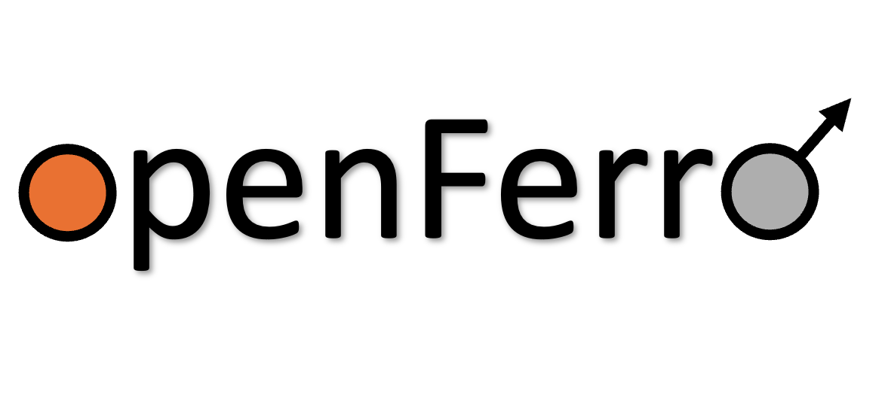
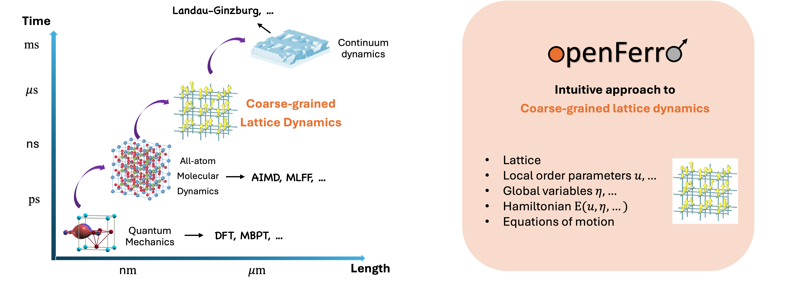
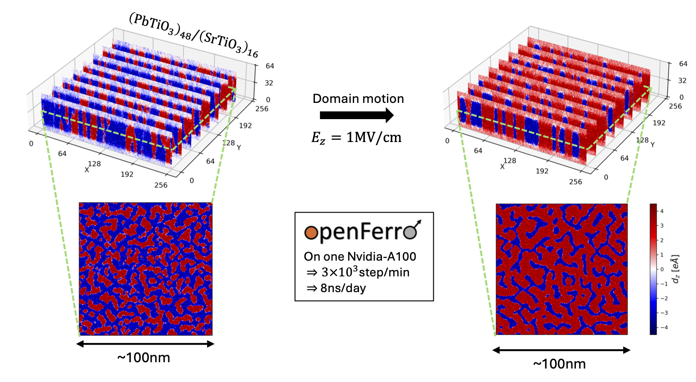
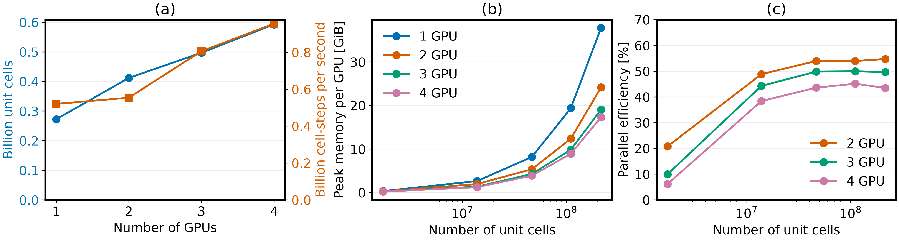

<p align="center">
  
</p>

# OpenFerro

A JAX-based framework for on-lattice atomistic dynamics.

OpenFerro 0.3.0 assembles lattice Hamiltonians from fields and interaction
energies, derives forces with automatic differentiation, and simulates coupled
ferroelectric, elastic, and magnetic degrees of freedom. Models can combine
built-in Hamiltonian terms with custom JAX energy functions.

> [!IMPORTANT]
> OpenFerro is a research alpha. A callable API is not necessarily a
> scientifically validated API. Review the
> [feature-status matrix](docs/source/feature_status.rst) before using an
> engine, integrator, or distributed path for scientific production.

## Highlights

- **JAX execution** on CPU and NVIDIA GPU backends.
- **Automatic forces** from scalar, functionally pure energy engines.
- **Composable models** built from self, mutual, and triple interactions.
- **Flexible state** including scalar, real-vector, local/global strain, and
  fixed-magnitude three-vector fields.
- **Constrained fields** through `MaskedRn` site masks,
  `MaskedLocalStrain` linear constraints, and `FrozenIntegrator` for fields
  held fixed during minimization or dynamics.
- **Minimization and dynamics** through gradient descent, NVE, NVT, and NPT
  drivers, Leapfrog and LFMiddle Langevin MD, and semi-implicit B (SIB)
  Landau-Lifshitz integrators.
- **Fixed-height metadynamics** in NVT or NPT, with one to three differentiable
  collective variables, grid-based bias, polynomial walls, and HILLS output.
- **Experimental sharding** across multiple devices and hosts.

Metadynamics currently requires single-device fields. Its drivers reject
distributed fields with `NotImplementedError`. The
[feature-status matrix](docs/source/feature_status.rst) records the geometry,
field-count, and validation limits of the other workflows.

## Installation

OpenFerro 0.3.0 is installed from source. Use a Python environment satisfying
the package compatibility ranges:

- Python `>=3.13,<3.15`
- JAX `>=0.10,<0.12`
- NumPy `>=2.0,<3`

Clone the repository and install OpenFerro:

```bash
git clone https://github.com/salinelake/OpenFerro.git
cd OpenFerro
python -m pip install .
JAX_PLATFORMS=cpu python -c "import openferro as of; print(of.System)"
```

For editable development and CPU checks, including the analysis tests:

```bash
python -m pip install -e ".[test]" matplotlib
JAX_PLATFORMS=cpu python -m pytest tests/unit_tests -q \
    -m "not slow and not stochastic and not gpu"
```

Matplotlib is used by the analysis scripts and plotting tests. The `slow`,
`stochastic`, and `gpu` markers select additional execution and numerical
checks; the short CPU run above is not the complete validation suite.

For NVIDIA GPUs, first install the JAX accelerator build appropriate for the
system, following the [official JAX installation guide](https://docs.jax.dev/en/latest/installation.html),
then install OpenFerro with `python -m pip install --no-deps .`. See the
[complete installation guide](docs/source/installation.rst) for details.

## Quick start

The public construction flow is lattice → system → fields → interactions →
integrators → simulation. This minimal example defines a harmonic vector field
and evolves it with conservative Leapfrog dynamics. On HPC systems, run
simulations and numerical tests inside a scheduler allocation.

```python
import jax.numpy as jnp

import openferro as of


lattice = of.SimpleCubic3D(2, 2, 2)
system = of.System(lattice)
field = system.add_field("u", ftype="R3", value=(0.0, 0.0, 0.1))


def harmonic_energy(u, parameters):
    k = parameters[0]
    return 0.5 * k * jnp.sum(u**2)


system.add_self_interaction(
    "harmonic",
    field_ID="u",
    energy_engine=harmonic_energy,
    parameters=[2.0],
)
field.set_integrator("adiabatic", dt=0.01)
simulation = of.SimulationNVE(system)
simulation.init_velocity(mode="zero")
simulation.run(10)

system.update_force()

print(system.calc_total_potential_energy())
print(field.get_force()[0, 0, 0])
```

Energy engines receive field values first and parameters last, remain free of
I/O and mutation, and return one scalar energy. OpenFerro JIT-compiles the
engine and obtains force as the negative energy gradient. Continue with the
[quick-start guide](docs/source/quickstart.rst) or the
[tutorial notebook](tutorials/quickstart.ipynb).

## Model structure

<p align="center">
  
</p>

A `System` owns:

1. a periodic Bravais lattice and its neighbor-shell geometry;
2. lattice fields such as local modes, dipoles, strains, or spins;
3. interaction wrappers around built-in or user-defined energy engines.

Each field selects its own integrator; a simulation driver coordinates force
updates, field evolution, random keys, and reporting. `FrozenIntegrator`
holds selected fields fixed while their interactions remain in the
Hamiltonian. Masked fields retain full lattice arrays and project inactive
values, velocities, and assembled forces to zero.

Real-valued fields use gradient-descent, Leapfrog, or LFMiddle integrators.
Fixed-magnitude `SO3` dynamics uses conservative, damped, or stochastic SIB
integration and is currently limited to one such field per simulation. NPT
dynamics treats engineering Voigt strain as a global field and uses
`V0 * det(I + eta)` as the default pressure volume. An explicit strain
reference volume and elastic cell count let padded models distinguish their
thermodynamic volume from the lattice/Ewald box.

## Maintained examples

| Example | Purpose | Status |
| --- | --- | --- |
| [`01.BTO_Cooling`](examples/01.BTO_Cooling) | BaTiO3 cooling with Ewald, local/global strain, minimization, and NPT Langevin dynamics. | Stable entry point |
| [`02.bcc_Fe_Heating`](examples/02.bcc_Fe_Heating) | Four-shell bcc Fe Heisenberg heating with stochastic SIB dynamics. | Stable entry point |
| [`03.sc_Ising_Heating`](examples/03.sc_Ising_Heating) | Simple-cubic continuous Heisenberg heating; the directory name is historical. | Stable entry point |
| [`04.PTOSTO_superlattice`](examples/04.PTOSTO_superlattice) | Field-driven PTO/STO domain dynamics and visualization on one GPU. | Experimental model |
| [`04a.PTOSTO_superlattice_large`](examples/04a.PTOSTO_superlattice_large) | Distributed PTO/STO cooling, plus domain analysis and visualization. | Experimental model and parallel execution |
| [`05.BTO_GPU_Parallel`](examples/05.BTO_GPU_Parallel) | Single-node BaTiO3 NPT strong scaling at 270 K. | Experimental multi-device benchmark |
| [`06.BTO_nanoparticle`](examples/06.BTO_nanoparticle) | Masked BaTiO3 soft modes, surface hardening, and polarization/susceptibility analysis. | Experimental nanoparticle workflow |
| [`07.MetaDynamics`](examples/07.MetaDynamics) | Two-CV NVT metadynamics for an analytically solvable four-well model. | Experimental sampling validation |
| [`08.BTO_MetaD`](examples/08.BTO_MetaD) | Three-CV BaTiO3 polarization metadynamics at constant pressure. | Experimental; single-device fields |
| [`09.SMO`](examples/09.SMO) | Frozen-structure and coupled spin–lattice heating in strained SrMnO3. | Experimental coupled model |

Launch examples from their own directories unless explicit configuration
paths are supplied. Reduced execution modes for examples 01–04 and 06–08 are
covered by smoke tests; these short trajectories do not establish production
sampling convergence. See the [examples index](examples/README.md) and the
individual scripts or READMEs for run controls and output formats.

The PTO/STO examples currently omit STO's homogeneous elastic contribution.
The [deferred correction](examples/04.PTOSTO_superlattice/README.md) can affect
equilibrium strain and domain behavior. The SrMnO3 coupled model is an
extension of separate ferroelectric and magnetic references; its example
documents the modeling assumptions.

<p align="center">
  
</p>

## GPU benchmark

The BaTiO3 benchmark retains onsite, short-range, Ewald, and strain terms in
NPT dynamics at 270 K. The driver,
[`strong_scaling.py`](examples/05.BTO_GPU_Parallel/strong_scaling.py), records
compilation time, median step time, JAX allocator peak memory, and run metadata
in a CSV file. Use it on an allocated GPU node with a mesh-compatible lattice
size. Scaling depends on system size and communication overhead.

<p align="center">
  
</p>

See the [benchmark methodology and results](examples/05.BTO_GPU_Parallel/README.md).
The included figure illustrates measurements from a particular machine and
software stack. Validate both performance and numerical results for the
device layout and physical model used in a production calculation.

## Model records

The JSON files under [`model_configs/`](model_configs) are documented parameter
records with provenance, units, conventions, and independently checked
reference observables. They are not inputs to a closed package-wide schema:
applications read the sections they need and map them to the ordinary OpenFerro
construction API. See [Model records](model_configs/README.md).

## Documentation and support

- [Documentation](https://openferro.readthedocs.io/)
- [API reference](https://openferro.readthedocs.io/en/latest/api.html)
- [Scientific conventions](docs/source/scientific_conventions.rst)
- [Dynamics and metadynamics](docs/source/theory-dynamics.rst)
- [Feature status and limitations](docs/source/feature_status.rst)
- [FAQ](docs/source/faq.rst)
- [Issue tracker](https://github.com/salinelake/OpenFerro/issues)

## Citation

Until a dedicated OpenFerro software paper or archival DOI is available, cite
the software repository with its version and access date:

> Pinchen Xie, *OpenFerro*, version 0.3.0, computer software,
> https://github.com/salinelake/OpenFerro.

Machine-readable metadata is provided in [`CITATION.cff`](CITATION.cff).

## Contributing and license

Contributions are welcome through issues and pull requests. OpenFerro is
released under the [MIT License](LICENSE). 

OpenFerro Copyright (c) 2025, The Regents of the University of California,
through Lawrence Berkeley National Laboratory (subject to receipt of any
required approvals from the U.S. Dept. of Energy). All rights reserved.

If you have questions about your rights to use or distribute this software, please contact Berkeley Lab's Intellectual Property Office at IPO@lbl.gov.

NOTICE.  This Software was developed under funding from the U.S. Department of Energy and the U.S. Government consequently retains certain rights.  As such, the U.S. Government has been granted for itself and others acting on its behalf a paid-up, nonexclusive, irrevocable, worldwide license in the Software to reproduce, distribute copies to the public, prepare derivative works, and perform publicly and display publicly, and to permit others to do so.