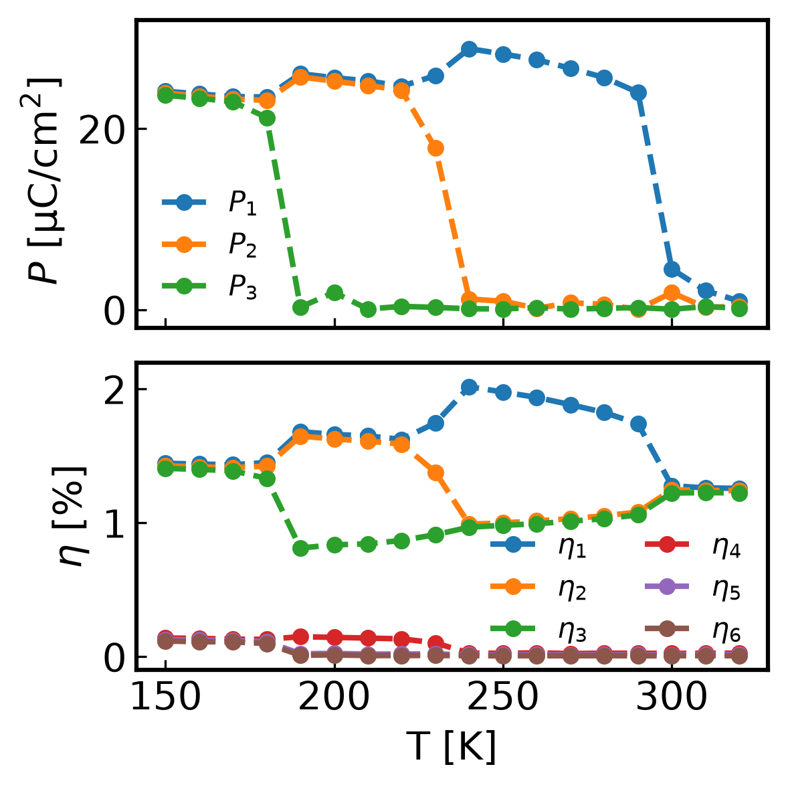

## Phase transition in BaTiO3

This example reads the documented `BaTiO3.json` effective-Hamiltonian record
with Python's standard JSON library and maps its parameters directly to
OpenFerro calls. The default run uses a 24x24x24 cell at -48 kbar, a 0.002 ps
time step, and a temperature schedule from 320 K down to 150 K. At each
temperature it performs 10 ps of equilibration and 50 ps of sampling.

Run from this directory because the default configuration and output paths are
relative to the working directory:

```bash
python npt.py
python npt.py --tiny --output-dir /tmp/openferro-bto-smoke
```

`--tiny` uses a 2x2x2 cell, invokes the same minimization stage (with a maximum
of 1,000 iterations), and performs one equilibration and one sampling step at
300 K. It is an execution smoke test, not a production result. `--size`,
`--seed`, `--config`, and `--output-dir` are also available. The example uses
OpenFerro's default determinant pressure-volume convention.

Run `python analyze.py` to regenerate `field_avg.png`. Error bars show plus or
minus one standard error estimated from ten contiguous time blocks (5 ps per
block for the default run), including both polarization and strain. These
finite-trajectory estimates do not establish convergence near phase transitions.

<p align="center" >
  
</p>
